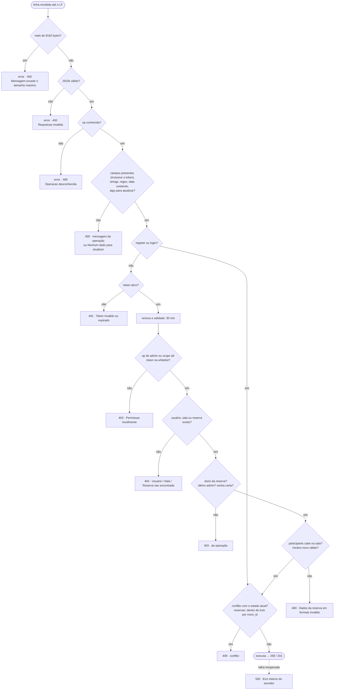
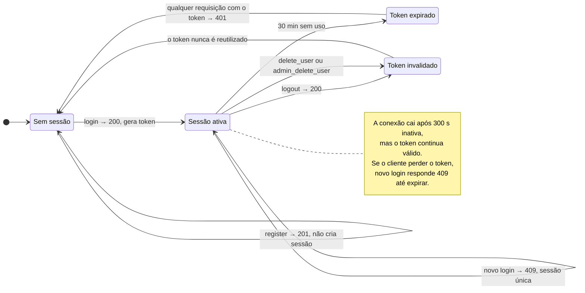
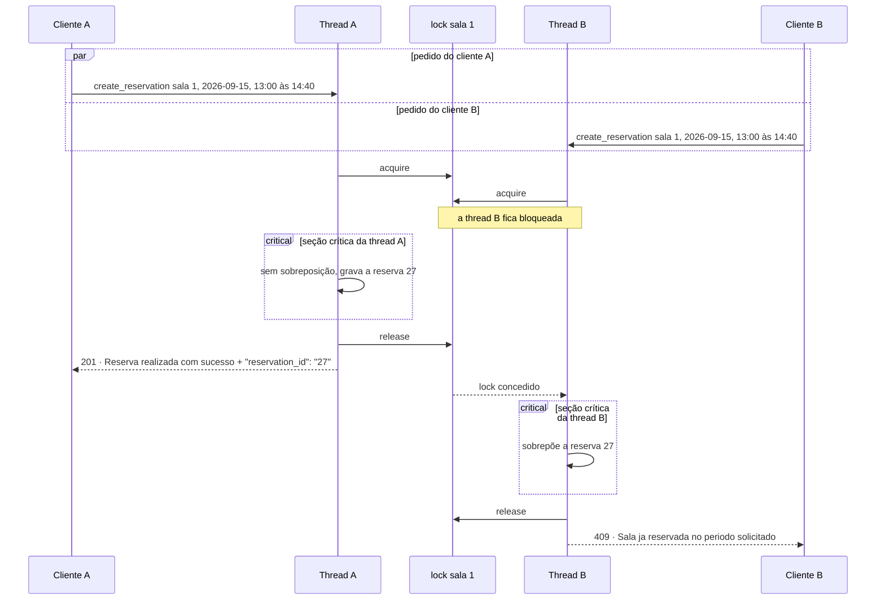

# Protocolo · Reserva de Salas

Protocolo de troca de mensagens do **Sistema Inteligente de Reserva de Salas de Reunião/Estudo em Campus**,
da disciplina de Sistemas Distribuídos (BCC, UTFPR-PG, Prof. Dr. Richard Ribeiro).
Responsáveis pelo protocolo: Pedro Silveira e Daniel Jesus.

**Documentação:** https://pedrosalvatori.github.io/protocolo-reserva-salas/

O contrato está em [`asyncapi.yaml`](asyncapi.yaml) (AsyncAPI 3.0), o equivalente do Swagger/OpenAPI para APIs
de mensagens. A página acima é montada a partir dele: editou o YAML e deu push, a documentação muda.

## Resumo

| | |
|---|---|
| Transporte | TCP. O servidor escuta numa porta digitada e usa uma thread por conexão. |
| Mensagem | 1 objeto JSON em **uma linha**, UTF-8, terminado por `\n`, até 8192 bytes. |
| Interação | Cada requisição recebe exatamente 1 resposta; o `op` da resposta é o `op` da requisição + `_response`. |
| Valores | Todos são strings: `"capacity": "12"`, `"available": "true"`. |
| Horários | Código da UTFPR, dia + turno + aula: `2M1` = segunda, manhã, primeiro horário. Cada sala lista em `slots` os horários em que funciona. |
| Autenticação | O `login` devolve um `token` de 64 hex, que vai em toda requisição, exceto `register` e `login`. Vale 30 min sem uso. |
| Operações | 21: autenticação (3), próprio cadastro (3), administrador (4), salas (5) e reservas (6). |

## Usando a documentação

- **Busca** (tecla `/`): filtra pelo nome da operação, por campo (`room_id`), por mensagem (`Token invalido`) ou por status (`409`).
  O endereço ganha `?q=`, então dá para mandar o link da busca para o grupo.
- **Link direto:** abrir uma operação muda o endereço para `#/grupo/operacao`.
- **Try it out:** parte do exemplo da operação, valida a mensagem contra o contrato, gera o comando `nc` (Linux/macOS)
  ou PowerShell para mandar ao seu servidor e valida a resposta que ele devolveu. Cole o token do `login` em
  **Token da sessão** para ele entrar nas próximas mensagens.

## Testar o servidor de vocês

O navegador não abre conexão TCP, então o teste roda no terminal. Precisa só do Node 18 ou mais novo,
sem `npm install`:

```
git clone https://github.com/pedrosalvatori/protocolo-reserva-salas.git
cd protocolo-reserva-salas
node scripts/testar-servidor.mjs
```

O testador pergunta o IP e a porta, e usa o admin inicial (`admin@admin.com` / `admin`, regra 3.15) para os
testes de admin e de salas. Também dá para passar direto:

```
node scripts/testar-servidor.mjs 127.0.0.1 5000
```

Se o grupo trocou a senha do admin, passe a conta com `--admin email:senha`. Para pular os testes de admin, use
`--admin -`.

Ele roda mais de 90 testes e confere cada resposta contra o `asyncapi.yaml`, inclusive o texto exato da
`message`. Os testes cobrem:

- formato e erros de protocolo;
- cadastro, login, token e próprio cadastro;
- administrador e salas (com o admin inicial), incluindo os horários no código da UTFPR e a agenda da sala;
- reservas, incluindo duas reservas no mesmo horário ao mesmo tempo, que testa o lock por sala;
- sessão, incluindo dois logins simultâneos;
- remoção de conta.

Cada falha mostra o que veio e o que era esperado. No fim, o testador apaga os usuários, a sala e as reservas
que criou.

Para mandar mensagens à mão e ver cada resposta validada, use o modo interativo:

```
node scripts/testar-servidor.mjs 127.0.0.1 5000 --interativo
```

Nele você digita uma linha JSON ou só o nome da operação (ex.: `login`), e o testador manda o exemplo do
contrato, reaproveitando o token do último login.

## Editando o protocolo

1. Edite o `asyncapi.yaml`. No VS Code, a extensão **AsyncAPI Preview** mostra a prévia (`Ctrl+Shift+P` → `AsyncAPI: Preview`).
2. Valide com `npm install` e `npm run validate`. O script confere a estrutura com o parser oficial do AsyncAPI
   e valida todos os exemplos contra os esquemas.
3. Para ver a página na sua máquina, sirva a pasta por HTTP: `python -m http.server 8000` (ou `npm run serve`)
   e abra http://localhost:8000 (ou http://localhost:3000). Abrir o `index.html` com dois cliques não funciona:
   o navegador bloqueia os scripts em arquivos locais.
4. Faça commit e push. O GitHub Actions roda a mesma validação em todo push e pull request, e o GitHub Pages publica a página.

## Fluxos

O AsyncAPI descreve cada mensagem, mas não a ordem entre elas. Estes três diagramas cobrem isso.

### Ordem de validação no servidor

Obrigatória desde a v2.9 (seção 4 do contrato). O primeiro passo que falhar define a resposta.



### Sessão e token



### Concorrência: lock por sala

Verificar a disponibilidade e gravar a reserva acontecem na mesma seção crítica, com lock por `room_id`.
O primeiro a obter o lock recebe 201; o segundo, 409.



## Pendências

Pontos que a planilha v2.0 não resolve e que afetam a conversa entre implementações de grupos diferentes:

1. **Resolvida na v2.9.** Token ausente → 400, como qualquer campo obrigatório; 401 fica para token sem sessão ativa.
2. **Resolvida na v2.1.** `delete_user` com senha incorreta respondia 401, o que fazia o cliente descartar um token que o servidor mantinha ativo. Agora responde 403 "Senha incorreta".
3. **Resolvida na v2.9.** `update_room` com `capacity` abaixo dos `participants` de uma reserva ativa → 409 "Capacidade menor que participantes de reservas ativas".
4. **Resolvida.** `scope` ∈ {mine, all} e `min_capacity` no formato de `capacity`, que não estavam no Dicionário, ficaram definidos no contrato.
5. **Resolvida na v2.9.** `resources` no `update_room`: `[]` mantém, lista nova substitui, `["0"]` apaga todos.
6. **Resolvida na v2.9.** A ordem de validação ficou obrigatória (diagrama acima).
7. **Sessão presa:** se o cliente perder o token sem fazer logout (app fechado, travamento), um novo login responde 409 por até 30 min, e o logout exige o token perdido. A senha de confirmação errada (v2.1) e o logout depois de inatividade (v2.2) já não causam isso; o caso do app fechado continua em aberto.
8. **Resolvida na v2.9.** Maiúsculas em `user` e `email` → 400; o servidor não converte.
9. **Resolvida na v2.7.** `room_status`: `active` = livre para reservas, `inactive` = indisponível (manutenção, limpeza).
10. **Resolvida na v2.9.** `update_reservation` é só do dono: o admin lê e cancela reservas de terceiros, mas não altera (403).

## Versões

### 2.9.0 (dúvidas de implementação)

Respostas às perguntas que os grupos mandaram enquanto implementavam a v2.8 (seções 4 e 9 do contrato).

| # | Dúvida | Resposta |
|---|---|---|
| 1 | `update_room` reduzindo `capacity` abaixo dos `participants` de uma reserva futura | **409 "Capacidade menor que participantes de reservas ativas"**. Reserva ativa = ainda não terminou (data + `end_time` no futuro). |
| 2 | `resources` no `update_room`: `[]` esvazia ou mantém? Itens têm regex? | `[]` **mantém**; lista nova substitui; **`["0"]` apaga todos**. Cada recurso segue `^[A-Za-z0-9 -]{1,30}$` e não pode ser `"0"`. |
| 3 | `update_reservation` numa sala `inactive` | Mudar `start_time` ou `end_time` → **409 "Sala indisponivel para reserva"**. Mudar só `topic` ou `participants` continua permitido. |
| 4 | 403 de dono antes ou depois do 404? | **404 antes do 403 de dono** (reserva inexistente é 404 para qualquer um). O 403 de admin (`scope: "all"`, op de admin) vem antes do 404. |
| 5 | `participants > capacity` e a ordem | É 400 **depois** do 401, 403 de perfil, 404 e 403 de dono, e **antes** dos 409. |
| 6 | Data que passa na regex mas não existe (`2026-02-30`) | **400** com a message de formato da operação. A regex também ficou mais estrita (mês 01–12, dia 01–31). |
| 7 | "Data passada" compara só a data? | Compara **data + `start_time`**: hoje vale, mas só numa aula que ainda não começou. No `update_reservation`, um `start_time` novo no passado também é 400. |
| 8 | Consultas com data passada | **Aceitas** (`read_room`, `list_rooms`, `check_availability`, `list_reservations`). Só criar e alterar reserva olham o passado. |
| 9 | Admin inicial com conta `admin`/`admin@admin.com` já existente | O servidor cria o admin ao iniciar, antes de aceitar conexões. Se houver conflito (banco antigo), **não cria nem promove**: avisa no log e o grupo corrige o banco. |
| 10 | `delete_room` e as reservas encerradas | Apagadas junto com a sala, como na remoção de conta. Reserva ativa continua bloqueando (409 "Sala possui reservas ativas"). |

Também na 2.9.0:

- **Nada para atualizar:** `update_room` (tudo `""`, `resources: []`, `slots` ausente ou `[]`) e `update_reservation`
  (os quatro campos `""`) respondem **400 "Nenhum dado para atualizar"**, como o `update_user` desde a 2.4.
- **Token ausente → 400** (era 400 ou 401). **Maiúsculas** em `user`/`email` → 400, sem converter.
- **Só o dono altera a reserva**, inclusive para o admin (403).

```json
{"op": "update_room", "token": "...", "room_id": "1", "name": "", "capacity": "16", "location": "", "resources": [], "room_status": ""}
{"op": "update_room", "token": "...", "room_id": "1", "name": "", "capacity": "", "location": "", "resources": ["0"], "room_status": ""}
```

A primeira muda só a capacidade e mantém os recursos; a segunda apaga todos os recursos.

O que cada grupo precisa mudar:

- **Servidor:** `resources` com `[]`/`["0"]` e regex dos itens; o 409 de capacidade; o 409 de sala `inactive` no
  `update_reservation`; o 400 "Nenhum dado para atualizar" no `update_room` e no `update_reservation`; seguir a ordem
  de validação; data inexistente → 400; passado = data + hora; apagar as reservas encerradas no `delete_room`.
- **Cliente:** no `update_room`, mandar `resources: []` quando o recurso não mudou e `["0"]` para apagar todos;
  tratar as respostas novas.

### 2.8.0 (horários das salas no código da UTFPR)

Pedido da Entrega 2 (itens d, e, f): cadastrar, ler e alterar salas com dias da semana e horários. A 2.7.0 fez
isso com dois campos (`days` e `slots`); a 2.8.0 passa a usar o código da UTFPR, que já junta os dois.

- **`slots` no código da UTFPR: dia + turno + aula.** `2M1` = segunda-feira, turno da manhã, primeiro horário;
  `4T3` = quarta-feira, tarde, terceiro horário. O campo `days` saiu. Cada dia pode ter horários diferentes, como
  na grade de aulas.

  - dia: `2` segunda, `3` terça, `4` quarta, `5` quinta, `6` sexta, `7` sábado;
  - turno: `M` manhã, `T` tarde, `N` noite;
  - aula: `1` a `6` na manhã e na tarde, `1` a `5` na noite (horários na tabela abaixo).

  ```json
  {"op": "create_room", "token": "...", "name": "Sala de Estudo B12", "capacity": "12", "location": "Bloco B - 1 andar", "resources": ["projetor"], "slots": ["2M1", "2M2", "2M3", "3T1", "3T2", "3T3", "5N1", "5N2"]}
  ```

  `slots` é obrigatório no `create_room` e volta no `read_room` e no `list_rooms`. No `update_room`, ausente ou
  `[]` mantém; uma lista nova substitui a antiga inteira.

- **Reservas seguem a tabela de aulas.** `start_time` é o início de uma aula e `end_time` o fim de uma aula
  (ex.: `13:00`–`14:40` = T1 + T2). Outro valor (como `14:00`) → 400. O dia sai do `date`: reservar 13:00–14:40
  numa terça exige `3T1` e `3T2` nos `slots` da sala; se faltar algum → **409 "Horario fora do funcionamento da
  sala"**, e `check_availability`/`list_rooms` respondem `"available": "false"`.

  | turno | 1 | 2 | 3 | 4 | 5 | 6 |
  |---|---|---|---|---|---|---|
  | M (manhã) | 07:30–08:20 | 08:20–09:10 | 09:10–10:00 | 10:20–11:10 | 11:10–12:00 | 12:00–12:50 |
  | T (tarde) | 13:00–13:50 | 13:50–14:40 | 14:40–15:30 | 15:50–16:40 | 16:40–17:30 | 17:30–18:20 |
  | N (noite) | 18:40–19:30 | 19:30–20:20 | 20:20–21:10 | 21:20–22:10 | 22:10–23:00 | |

- **Agenda da sala.** `read_room` com `date` devolve `agenda`: um item por horário da sala naquele dia da semana
  (ex.: `3T1`), com `slot_status` `"livre"` ou `"indisponivel"` e, nos reservados, quem reservou (`user`). O
  `reservation_id` só vai para o admin e para o dono da reserva.
- `room_status`: `active` = livre para reservas; `inactive` = indisponível (manutenção, limpeza).

O que cada grupo precisa mudar:

- **Servidor:** guardar os `slots` da sala; aceitar só início e fim de aula nas reservas; responder o 409 novo;
  montar a agenda do `read_room`.
- **Cliente:** no cadastro e na edição de sala, mostrar a grade (dias × aulas) para marcar os horários; nas
  reservas, escolher aulas da tabela em vez de digitar a hora; mostrar a agenda da sala.

### 2.7.0 (horários das salas, primeira versão)

- Salas com dias (`days`) e aulas (`slots`) em campos separados, e reservas pela tabela de aulas da UTFPR.
  Trocada no mesmo dia pela 2.8.0, que usa o código da UTFPR (`2M1`).

### 2.6.0 (admin inicial)

- **Todo servidor começa com o mesmo admin.** Quando não há nenhum usuário `admin` no banco (por exemplo, na
  primeira execução), o servidor cria a conta:

  | user | email | senha | role |
  |---|---|---|---|
  | `admin` | `admin@admin.com` | `admin` | `admin` |

  Antes, como o `register` sempre cria `user` e só um admin promove alguém, o primeiro admin precisava ser
  inserido no banco à mão, e cada grupo usava uma conta diferente (regra 3.15).
- O testador entra com essa conta por padrão.

O que cada grupo precisa mudar: no servidor, criar o admin inicial ao iniciar quando não existir nenhum admin.

### 2.5.0 (whitelist de tokens de admin)

- **Só a whitelist libera ações de admin.** O servidor mantém uma lista dos tokens com poder de admin, e as
  operações de admin (`admin_*`, criar/alterar/remover sala, `scope: "all"`, ações sobre reservas de terceiros)
  só aceitam tokens dessa lista. Fora dela: 403 "Permissao insuficiente" (regra 3.14).
- **O token entra na lista** no login de uma conta admin, ou quando um admin promove um usuário que está logado.
  **Sai da lista** na hora em que a conta é rebaixada, no logout, na expiração e na remoção da conta, sem esperar
  novo login.
- **O `role` nunca vem do cliente.** O `role` do `login_response` só serve para montar a tela. Um `role` enviado em
  qualquer requisição (fora do `admin_update_user`) é ignorado.

Antes, um servidor que guardasse o `role` do momento do login deixava um admin rebaixado com poderes de admin até
o token expirar, e nada proibia confiar num `role` vindo do cliente.

O que cada grupo precisa mudar: no servidor, manter a whitelist e conferir por ela (e atualizá-la no
`admin_update_user`); no cliente, usar o `role` só para a interface.

### 2.4.0 (alteração de usuário sem nada para mudar)

- `update_user` com `user` e `password` vazios, ou `admin_update_user` com `user`, `password` e `role` vazios,
  respondia **200 "Dados atualizados com sucesso"** sem mudar nada. Agora responde
  **400 "Nenhum dado para atualizar"** (regra 2.13).

O que cada grupo precisa mudar: no servidor, checar esse caso antes de gravar e responder o 400 com essa
message; no cliente, mostrar a mensagem (ou nem enviar quando o formulário estiver todo vazio).

### 2.3.0 (remoção de conta)

- **Remover uma conta apaga tudo dela.** `delete_user` e `admin_delete_user` apagam o cadastro, encerram a sessão
  e apagam **todas** as reservas do usuário, passadas e futuras. O `user` e o `email` ficam livres, e outra pessoa
  pode se cadastrar com os mesmos dados (201). Antes só as reservas futuras eram canceladas, e um novo cadastro com
  o mesmo `user` podia herdar as reservas antigas, inclusive ler e cancelar o que não era dele (regra 3.13).
- **Testador automático:** `node scripts/testar-servidor.mjs` (ver "Testar o servidor de vocês").

O que cada grupo precisa mudar: no servidor, apagar cadastro, sessão e todas as reservas ao remover uma conta.

### 2.2.0 (sessão e login)

Nenhuma mensagem mudou, só regras de comportamento:

- **Logout depois de 5 min parado não deixa mais a sessão presa.** O servidor fecha a conexão após 300 s sem
  mensagens. Se o cliente mandava o logout no socket fechado e descartava o token sem resposta, o servidor
  mantinha a sessão e o login seguinte respondia 409. Agora o cliente reconecta e reenvia (regra 1.11), e só
  descarta o token depois de receber o `logout_response` (regra 3.10).
- **Login simultâneo não cria duas sessões.** Checar se há sessão ativa e criar o token acontecem na mesma
  seção crítica (lock por usuário ou restrição UNIQUE no banco). Com dois logins ao mesmo tempo, um recebe
  200 e o outro 409 (regra 3.11).
- **O login não revela mais quais contas existem.** Ordem obrigatória: formato (400) → credenciais (401) →
  sessão ativa (409). O 409 só aparece com email e senha corretos (regra 3.12).

O que cada grupo precisa mudar: no servidor, a ordem do login e o lock da sessão; no cliente, reconectar e
reenviar quando o socket estiver fechado, e só descartar o token depois do `logout_response`.

### 2.1.0

- **E-mail com `.com.br` e domínios institucionais.** A regex do `email` passou a ser
  `^[a-z0-9._-]+@[a-z0-9-]+(\.[a-z0-9-]+)*\.[a-z]{2,}$`. Ela aceita domínios com vários níveis e hífen
  (`joao@empresa.com.br`, `maria@alunos.utfpr.edu.br`, `ana@meu-provedor.com.br`) e `_` ou `-` antes do `@`.
  Todo e-mail válido na 2.0 continua válido, exceto os com terminação de 1 letra (`joao@email.c`).
- **Senha errada não derruba mais a sessão.** No `delete_user`, a senha de confirmação errada respondia 401.
  O cliente, seguindo a regra do 401, descartava o token e voltava ao login, mas o servidor mantinha a sessão
  ativa, e o login seguinte respondia 409 por até 30 min. Agora a resposta é **403 "Senha incorreta"**, nada
  é removido e a sessão continua.
- **Regra nova (3.9):** 401 só quando o servidor não tem sessão ativa para aquele token, ou no `login` com
  credenciais erradas. Assim o cliente sempre pode descartar o token ao receber 401.

O que cada grupo precisa mudar: a regex de e-mail no cliente e no servidor; no servidor, responder 403
"Senha incorreta" no `delete_user`; no cliente, tratar esse 403 sem descartar o token.

### 2.0.0

Versão da planilha *Protocolo de troca de Mensagens*.

## Estrutura

```
asyncapi.yaml            contrato do protocolo (fonte da verdade)
index.html, assets/      documentação no estilo Swagger, montada no navegador a partir do YAML
assets/validator.js      validador do Try it out e do testador (o CI confere que ele concorda com o Ajv)
assets/contract.js       leitura do contrato, usada pela página e pelo testador
assets/vendor/           js-yaml e marked (licença MIT)
scripts/testar-servidor.mjs  testador do servidor por TCP (bateria completa ou modo interativo)
scripts/validate.mjs     validação da especificação e dos exemplos
.github/workflows/       CI: npm run validate em todo push e pull request
```
